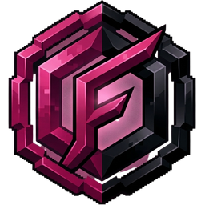
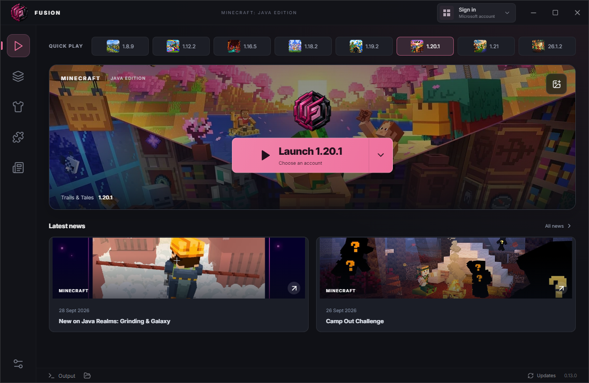
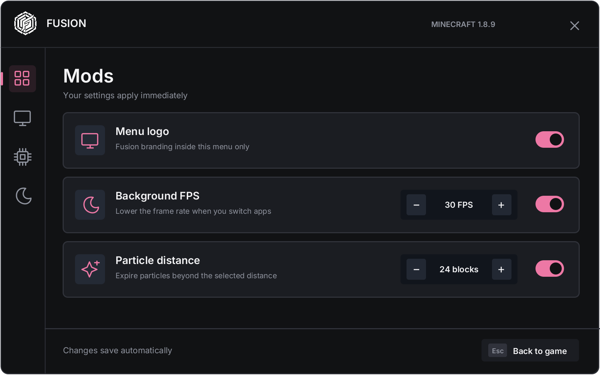
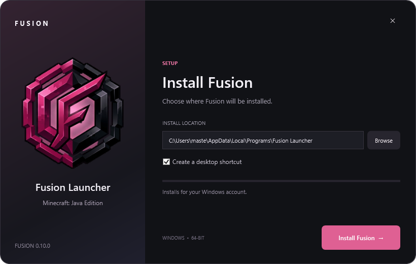
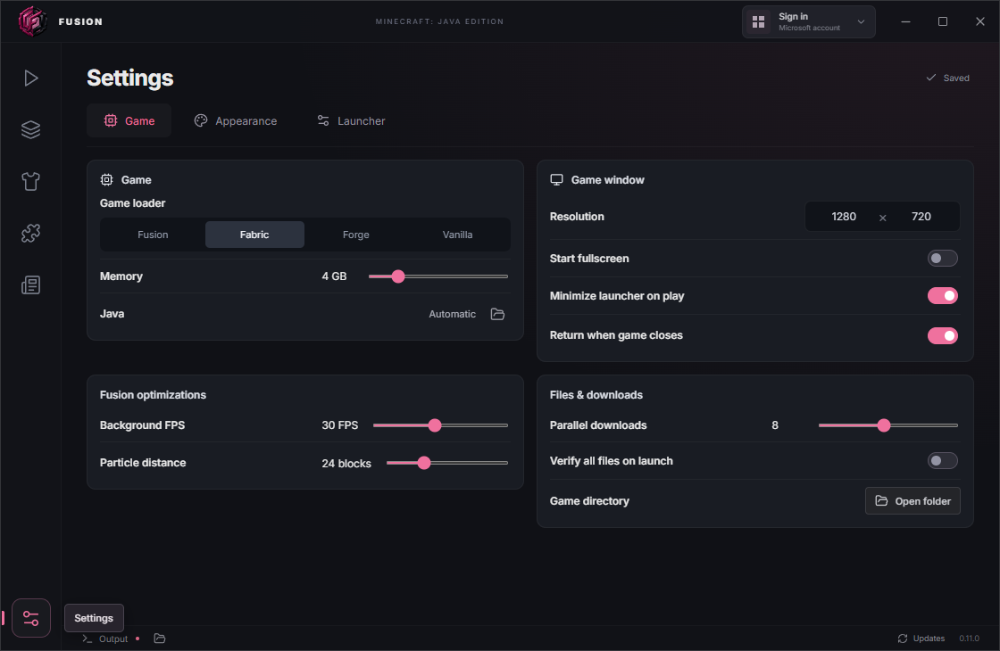

  
  <h1>FUSION</h1>
  
Your world. Your mods. Your way to play.

  
A Minecraft: Java Edition launcher for Windows.

  
<a href="https://github.com/MasterGab1/Fusion-Client/releases/latest">Download</a> · <a href="docs/UPDATES.md">Updates</a> · <a href="docs/PRIVACY.md">Privacy</a> · <a href="docs/TERMS.md">Terms</a>

## Jump straight in

Pick a version and play. Fusion remembers your settings, manages Java, and keeps your game installations organized. Bring your own background, build a skin library, and catch up with Minecraft news between sessions.

## Make it yours

- **Mods and modpacks.** Browse, select several mods, and download them together with required dependencies. Import `.mrpack` files or discover packs inside the launcher.
- **In-game controls.** Press **Right Shift** for a compact menu in your launcher theme. Adjust its size without leaving the game.
- **Useful extras.** Free look, hunger and estimated saturation, FPS, coordinates, background FPS and particle controls. Hold **Left Alt** for free look when enabled.
- **A quieter watermark.** A small white Fusion logo appears in menus, including inventory and pause. Normal gameplay stays clear.
- **Your preferences.** Themes, skin previews, optional Discord Rich Presence, and resizable, colored Output.

Built-in features work alongside supported Fabric and Forge mods. Fusion keeps the current version selection; it does not add unverified releases automatically. Saturation is a client estimate and may differ from the server. Individual mods and server rules can affect compatibility.

## Install once

Use the latest installer from [Releases](https://github.com/MasterGab1/Fusion-Client/releases). Fusion's custom setup, update screen and uninstaller keep the same look. Updates preserve your game data; uninstalling leaves worlds and preferences available for a future reinstall.

Downloads and in-app updates are public and do not require GitHub sign-in. See [update help](docs/UPDATES.md).

## Choose how to test

Sign in with Microsoft for an authenticated Minecraft profile. **Account → Local testing** lets you test singleplayer and the in-game menu without signing in. Local profiles cannot join servers that require authentication or upload an account skin.

The official Minecraft Launcher handoff remains available. If Microsoft rejects Fusion's app registration, see [sign-in help](docs/MICROSOFT-SETUP.md); registration approval cannot be changed by a launcher update.

## Project information

Fusion's original code and branding are proprietary. See [LICENSE](LICENSE), [Terms of use](docs/TERMS.md) and [Privacy](docs/PRIVACY.md). Third-party components keep their own licenses.

[Development](docs/DEVELOPMENT.md) · [Release notes](docs/RELEASE-0.13.0.md) · [Validation](docs/VALIDATION.md)

Fusion is independent of Mojang and Microsoft and is not an official Minecraft product.
