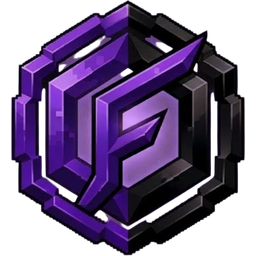
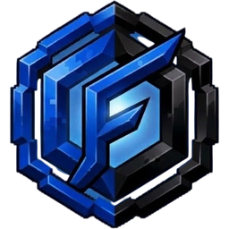
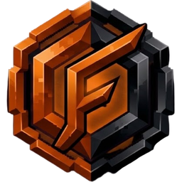

<div align="center">
  
  <h1>FUSION</h1>
  <p>A desktop launcher for Minecraft: Java Edition.</p>
  <p><b>Windows x64</b> · Browser sign-in · Custom installer · Built-in mods</p>
  <p><a href="https://github.com/MasterGab1/Fusion-Client/releases/latest">Download Fusion</a> · <a href="docs/MICROSOFT-SETUP.md">Sign-in help</a> · <a href="docs/UPDATES.md">Updates</a></p>
</div>


## Your launcher, your setup

Launch from the artwork, jump between favorite releases, or search the version picker. Fusion keeps Minecraft versions and profiles separate, remembers your preferences, and uses the correct Java runtime automatically.

| | Included |
|---|---|
| **Play** | One-click version shortcuts, family picker, bundled artwork, custom background import and reset |
| **Mods** | Fusion HUD, Focus and Particles; community mod discovery and automatic required dependencies |
| **Skins** | 3D preview, classic/slim models, PNG library, username downloads, account uploads |
| **News** | Official Minecraft stories with banners and cached reading |
| **Preferences** | Autosave, compact categories, memory/Java controls, five accent themes, motion controls and resizable output |
| **Discord** | Optional Rich Presence for the launcher and your running Minecraft version |

<div align="center">
  
  &nbsp;&nbsp;
  
  &nbsp;&nbsp;
  
  &nbsp;&nbsp;
  
  &nbsp;&nbsp;
  
</div>

## Fusion in game


Press **Right Shift** in a world to open the Fusion overlay. The menu uses a cached high-resolution texture, Inter typography, and your launcher accent. The white logo appears inside the menu; it stays hidden during normal gameplay.

- **Fusion HUD** controls the menu logo.
- **Fusion Focus** lowers the frame cap while Minecraft is unfocused and restores the game cap on return.
- **Fusion Particles** expires distant particles to reduce subsequent update/render work.

The same eight version families remain available: **1.8 · 1.12 · 1.16 · 1.18 · 1.19 · 1.20 · 1.21 · 26.1**. Fusion Runtime 0.5.0 includes mappings for all **49 existing releases** in those families. New releases are not offered until their runtime support is added. See [runtime details](docs/MODS.md).

Fusion's built-in modules also run alongside supported Fabric and Forge profiles. Select several mods across searches, then download them together with shared dependencies. The in-game Installed category lists your third-party mods. Downloads come from Modrinth, with required dependencies resolved and files verified before installation. See [community mods](docs/COMMUNITY-MODS.md).

## Install once, update in place


Download `Fusion-Setup-0.11.0.exe` from [Releases](https://github.com/MasterGab1/Fusion-Client/releases). Choose a folder and shortcut preference, then launch Fusion. The custom setup and uninstaller use the established NSIS engine. Uninstalling preserves your worlds, mods, skins and preferences.

Future releases download through **Updates** and install when you restart Fusion. Worlds, skins, settings and custom artwork remain in your Windows user-data folder.

**This repository is private.** Release downloads and updater checks need a GitHub account with access. On this PC, Fusion can use your existing Git Credential Manager sign-in; it never bundles credentials. See the [one-time updater setup](docs/UPDATES.md).

## Microsoft sign-in

Sign-in opens your browser and returns to Fusion through PKCE authorization. Direct launches verify a renewable Microsoft session, Java ownership and a Minecraft profile. There is one official edition and no offline-account mode.

The public Microsoft application ID is bundled, so players do not enter application IDs or device codes. The application's owner must configure its localhost redirect and obtain any required Minecraft API access. A server-side registration rejection cannot be fixed by rebuilding the launcher. For testing with your existing official launcher account, use **Sign in → Prepare Fusion installation**, then launch the generated Fusion installation from Minecraft Launcher. Fusion never imports its account files or tokens. Follow the [Microsoft setup guide](docs/MICROSOFT-SETUP.md).

## Compact preferences


Settings save automatically and survive navigation and restarts. Files live in `%APPDATA%\Fusion Launcher`; profile directories keep different releases and loaders apart. Background reset restores only the selected family's bundled artwork.

## Build locally

Requires Windows x64, Node.js 22+, a JDK supporting `--release 8` (tested with JDK 25), and Windows .NET Framework 4.x for the installer.

```powershell
npm ci
npm test
npm run dist
```

The final installer and update metadata are in `release-bundle/0.11.0/`. `npm run dev` starts the desktop development app. Nothing is published by `npm run dist`.

```powershell
npm run test:ui
npm run test:mods
node scripts/test-installer.cjs
node scripts/test-uninstaller.cjs
```

UI checks use isolated data and hidden Electron windows. Installer tests use an isolated mock engine and do not replace your installed launcher. Additional runtime audits and JVM binding checks use official cached client JARs; no game classes are distributed.

## Verification and limits

Validation includes 51 unit tests, hidden launcher UI checks with real batch mod downloads, installer/uninstaller mock-engine checks, runtime rendering tests, and real Fabric/legacy Forge prelaunch probes. The same 49 vanilla runtime profiles remain available, with 36 Fabric and 39 Forge mappings. Modern Forge profiles have not had equivalent live-loader QA. These checks do not replace gameplay testing on every release. No measured FPS gain is claimed. Direct Fusion sign-in and the official-launcher handoff still need a real-account check; direct sign-in depends on Minecraft accepting Fusion's application registration.

Fusion is an independent launcher and is not affiliated with Mojang or Microsoft. Third-party library notices are included in the application assets and runtime. Logos and version artwork are project-supplied assets; inclusion here does not grant additional rights to Minecraft artwork.
